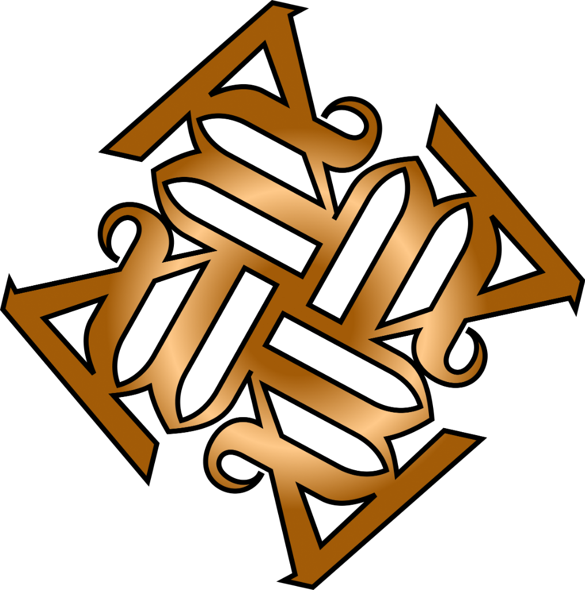

<div align="center">

  

  <br /><br />

  

  <p><strong>Yang diwariskan, yang kita teruskan.</strong></p>

  <p>
    <em>Sebuah ekosistem web interaktif yang menghidupkan kembali denyut budaya, kriya adiluhung, kidung tutur lisan, dan kearifan 38 provinsi Nusantara dalam kemasan editorial kontemporer.</em>
  </p>

  <p>
    <a href="showcase.html"></a>
    <a href="#pintu-masuk"></a>
    <a href="#creative-lab"></a>
    <a href="#arsitektur"></a>
  </p>

  <p>
    
    
    
    
    
  </p>

</div>

---

<a id="sekilas"></a>
## ✦ Sekilas Tentang WARISARA

> **WARISARA** berakar dari dua kata: **WARIS** (*Warisan adiluhung yang dititipkan*) dan **NUSANTARA** (*Hamparan kepulauan dan keragaman masyarakat Indonesia*).

Banyak generasi muda hari ini mengenal budaya hanya sebatas artefak bisu di balik etalase kaca museum atau lembaran teori buku pelajaran yang kaku. **WARISARA meruntuhkan sekat tersebut.**

WARISARA bukan sekadar ensiklopedia data atau kumpulan artikel pasif. **WARISARA adalah ruang hidup (*living cultural archive*)** di mana peta Nusantara menjadi pintu gerbang petualangan: Anda dapat menjelajahi 38 provinsi tanpa jeda, mendengarkan wejangan lisan asli dari para maestro kriya, menggoreskan kuas canting digital di atas kanvas interaktif, hingga merajut jejaring persaudaraan dengan pembuat karya otentik Nusantara.

```
PETA → PROVINSI → WARISAN → CERITA → MANUSIA → KARYA → PENGETAHUAN → GENERASI BERIKUTNYA
```

---

<a id="fitur-unggulan"></a>
## ✦ Mengapa Anda Harus Membuka & Menjelajahinya?

Website ini dirancang untuk membuat siapa pun—dari anak-anak hingga pemerhati budaya senior—terpikat sejak detik pertama dan ingin menjelajahinya hingga tuntas:

### 1. Peta Vektor 38 Provinsi yang Bernapas
Tidak ada halaman statis yang kaku. Di halaman utama, Anda disambut oleh peta vektor Nusantara interaktif:
- **Transisi Mulus (*Smooth Pan & Zoom*)**: Klik pulau atau provinsi mana pun untuk membuka **Province Discovery Sheet** yang memuat esensi budaya lokal dalam hitungan detik.
- **Kedalaman Konten Otentik**: Menampilkan kuliner pusaka yang khas, destinasi kultural berbobot, ragam dialek tutur asli, hingga kuis uji wawasan kedaerahan.
- **Paspor Penjelajah Digital**: Setiap provinsi yang Anda kunjungi akan dicap otomatis ke dalam paspor digital pribadi Anda.

<p align="center">
  
</p>

<a id="creative-lab"></a>
### 2. Creative Lab Studio 2.0 — Menenun Motif di Kanvas Digital
Bukan sekadar penonton, di sini Anda diajak menjadi perajin masa kini:
- **Generator Motif Parametrik**: Pilih ragam hias klasik Nusantara (Kawung, Megamendung, Parang Rusak, Truntum, Ceplok, hingga Songket Minang) dan atur densitas, perulangan, skala geometri, serta palet pewarna alaminya secara *real-time*.
- **Canting Tulis Manual**: Torehkan guratan lilin malam digital secara bebas langsung di atas kanvas HTML5 2D.
- **Simulasi Busana 3D**: Proyeksikan motif yang baru saja Anda rancang ke model busana tiga dimensi untuk melihat keanggunannya saat dikenakan.
- **Sertifikat Digital Karya**: Unduh mahakarya kriya digital Anda lengkap dengan sertifikat keaslian dan nomor registrasi personal.

<p align="center">
  
</p>

### 3. Cerita Pusaka Lisan — Buku Interaktif 3D Bersuara
Mendengarkan kisah bertutur selalu menyentuh relung batin terdalam:
- Buka lembaran buku 3D interaktif yang membawakan narasi adiluhung: rahasia layar perahu Pinisi pelaut Bugis-Makassar, mistisisme Tenun Gringsing Bali Aga, hingga filosofi tali Noken Papua.
- **Narator Suara Asli**: Didukung oleh mesin sintesis suara lisan (*Web Speech & Audio Synthesis*) dengan iringan instrumen etnik lembut yang larut dalam cerita.

<p align="center">
  
</p>

### 4. Belajar dari Akar & Kuis Budaya Interaktif
Mengubah pendidikan budaya lokal menjadi petualangan rasa ingin tahu:
- **8 Kategori Pusaka**: Dari Wastra, Arsitektur Adat, Tosan Aji & Senjata, Tarian & Teater, Musik & Bunyi, Mitos & Legenda, hingga Upacara Adat.
- **Tantangan Waktu & Skor Instan**: Kuis interaktif dengan hitung mundur dan papan evaluasi untuk mengukur kedalaman wawasan budaya Anda.
- **Bimbingan Maskot Wari**: Maskot interaktif yang memberikan konteks historis di setiap butir soal.

<p align="center">
  
</p>

### 5. Gerbang Masuk Nusantara & Persona Komunitas
Pintu silaturahmi digital bagi pemerhati kriya, kolektor, dan pegiat seni tradisi:
- **Kemudahan Akses**: Fitur 1-klik Google SSO dan simulasi profil persona (kolektor maupun perajin lokal).
- **Atmosfer Gerbang Candi**: Transisi visual bergaya gapura Nusantara dengan kartu kaca (*frosted glassmorphism*).

<p align="center">
  
</p>

### 6. Direktori 38 Maestro Adat & Suara Pelestari
Di balik setiap pusaka, ada tangan manusia yang mengabdikan seluruh jalan hidupnya:
- Eksplorasi profil 38 maestro tradisi dari 38 provinsi—mulai dari Empu Djeno Harumbrojo (penempa tosan aji di Surakarta), Ompu Sorta Silalahi (penenun ulos di Dairi), hingga para pemahat Asmat di pedalaman Papua.
- Dengarkan langsung petuah bijak mereka melalui pemutar audio bergelombang visual (*soundwave visualizer*), serta pelajari rahasia bahan alami yang telah terjaga berabad-abad.

### 7. Pasar Kriya Nusantara — Ekonomi Kreatif Berbasis Dialog
Bukan sekadar etalase komersial dingin:
- Menghubungkan pecinta kriya langsung dengan komunitas perajin lokal (*C2C Story-First Commerce*).
- Dilengkapi sistem percakapan personal (*direct chat*) untuk berdialog, memahami latar belakang filosofis di balik karya, hingga mengajukan pesanan kustom (*commission request*).

### 8. Sentuhan Detail & Estetika Mikroskopik
- **Lantern Cursor**: Kursor penunjuk bertransformasi secara dinamis menjadi lentera temaram dan canting tradisional saat Anda menjelajah.
- **Wari si Pemandu Budaya**: Maskot interaktif yang menemani langkah Anda dengan respon ekspresi dinamis (berpikir, tersenyum, menyapa).
- **Audio Ambience Nusantara**: Nuansa suara latar gamelan dan gesekan bambu yang menenangkan, dirancang dengan etika *user-initiated* (tidak pernah *autoplay* tanpa persetujuan).

---

<a id="filosofi-desain"></a>
## ✦ Filosofi Visual: "Nusantara Modern"

WARISARA menolak pendekatan klise yang menyematkan terlalu banyak ornamen emas berkilau atau warna merah-putih mencolok. Seluruh palet warna diangkat dari **material otentik alam Indonesia**, menghasilkan suasana layaknya museum seni rupa kontemporer kelas dunia:

| Elemen Material | Filosofi Budaya | Nilai Heksadesimal |
|:---|:---|:---:|
| **Indigo Tarum** | Warna celupan alami dari daun tarum pada wastra tenun tertua Nusantara; anggun, tenang, dan berwibawa. | `#16213A` |
| **Terracotta Gerabah** | Kehangatan tanah liat Kasongan dan tembikar bakar tradisional; simbol karya sentuhan tangan manusia. | `#C06A42` |
| **Hijau Kanopi Hutan** | Keteduhan rimba tropis dan daun jati; representasi kearifan lokal yang berakar kuat dan hidup. | `#2E4A38` |
| **Emas Kuningan (Brass)** | Kilau tempaan tosan aji dan benang songket lawas; mewah secara bersahaja tanpa kilau artifisial. | `#C9A567` |
| **Daluang Kuno** | Kertas serat pohon warisan kepustakaan Nusantara; kanvas dasar yang hangat dan ramah di mata. | `#F6F1E7` |
| **Tinta Arang Jati** | Hitam kecoklatan pekat untuk teks editorial yang tajam dan nyaman dibaca dalam waktu lama. | `#1A1612` |

### Standar Tipografi Editorial
- **Fraunces** (*Google Fonts*): Tipografi serif editorial dengan karakter lekukan hangat khas pahatan kayu Nusantara untuk *display headline* yang berwibawa.
- **Manrope** (*Google Fonts*): Tipografi sans-serif modern yang geometris, proporsional, dan sangat nyaman dibaca (*high legibility*) bagi semua generasi dari remaja hingga lansia.
- **Anti-Slop & Zero-Emoji**: Bebas dari emoji murah dan ikon generik. Seluruh simbol menggunakan standar resmi **Google Material Symbols** yang bersih dan presisi.

---

<a id="arsitektur"></a>
## ✦ Arsitektur Rekayasa: Kemurnian Performa

WARISARA membuktikan bahwa keindahan visual yang memukau dan interaktivitas tingkat tinggi dapat dicapai dengan arsitektur web yang murni, ringan, dan zero-bloat.

```
┌─────────────────────────────────────────────────────────────┐
│                    WARISARA CLIENT-SIDE                     │
├──────────────────────────────┬──────────────────────────────┤
│       LAPISAN TAMPILAN       │        LAPISAN LOGIKA        │
│  • Semantik HTML5            │  • Vanilla JavaScript (ES6+) │
│  • Tailwind CSS (Play CDN)   │  • HTML5 Canvas 2D Engine    │
│  • CSS Variables & Keyframes │  • Web Audio & Speech API    │
│  • Google Material Symbols   │  • LocalStorage State Engine │
└──────────────────────────────┴──────────────────────────────┘
```

- **Zero-Build Architecture**: Tidak memerlukan instalasi `node_modules` bergiga-gita ataupun kompilasi bundler yang rumit. Kode sumber langsung siap dieksekusi secara instan oleh mesin peramban.
- **Pemisahan Data Kultural Modular**: Seluruh basis pengetahuan budaya (`provinces.js`, `makers.js`, `stories.js`, `products.js`, `quiz.js`) terkelola secara terpisah dan bersih dari kode manipulasi antarmuka.
- **Aksesibilitas Universal (All Ages, One Experience)**: Memenuhi standar rasio kontras warna WCAG, target sentuh ramah layar sentuh (*touch-friendly*), dan navigasi keyboard yang bersahabat bagi pengguna ragam kemampuan.

---

<a id="pintu-masuk"></a>
## ✦ Pintu Masuk — Cara Menjalankan

Karena tidak memiliki dependensi server yang rumit, Anda dapat menjalankan dan menguji proyek ini dalam hitungan detik:

### Opsi 1: Buka Langsung (Paling Praktis)
1. Unduh atau salin (*clone*) repositori ini:
   ```bash
   git clone https://github.com/rendy/warisara-apps.git
   ```
2. Buka folder proyek:
   ```bash
   cd "WARISARA - Apps"
   ```
3. Klik ganda file `index.html` pada peramban web modern Anda (Google Chrome, Microsoft Edge, Mozilla Firefox, atau Apple Safari).

### Opsi 2: Menggunakan Live Server (Sangat Disarankan)
Untuk memastikan seluruh fitur Web Audio API, Canvas Blob Export, dan sintesis suara berjalan dengan izin keamanan peramban yang sempurna:

- **Melalui VS Code**:
  Pasang ekstensi *Live Server*, klik kanan pada file `index.html`, lalu pilih **"Open with Live Server"**.
  
- **Melalui Terminal Python 3**:
  ```bash
  python -m http.server 8080
  ```
  Buka alamat `http://localhost:8080` pada peramban.

- **Melalui Node.js**:
  ```bash
  npx serve .
  ```

---

<a id="peta-halaman"></a>
## ✦ Peta Navigasi & Struktur Berkas

```
WARISARA - Apps/
├── index.html                   # Gerbang Utama & Peta Nusantara Interaktif
├── pages/
│   ├── jelajahi.html            # Ensiklopedia Budaya 38 Provinsi & Paspor Digital
│   ├── creative-lab.html        # Studio Kreasi Wastra 2.0 & Simulasi Busana 3D
│   ├── cerita.html              # Buku Cerita Pusaka Lisan 3D & Audio Interaktif
│   ├── ekonomi-kreatif.html     # Pasar Kriya C2C & Dialog Komunitas
│   ├── belajar.html             # Ruang Micro-learning Kultural & Kuis Budaya
│   ├── detail-produk.html       # Lembar Rinci Cerita & Makna di Balik Produk
│   └── login.html               # Pintu Masuk Anggota Komunitas Pelestari
├── js/
│   ├── sections/                # Pengontrol logika tiap fitur dan kanvas studio
│   ├── components/              # Komponen modular (audio player, modal, kuis)
│   ├── utils/                   # Utilitas kursor lentera, transisi, dan maskot Wari
│   └── main.js                  # Titik awal orkestrasi aplikasi
├── data/                        # Basis data kebudayaan, 38 maestro, produk, & kuis
├── css/                         # Desain token, palet Nusantara, dan transisi halus
└── assets/                      # Vektor peta, potret pelestari, audio naskah, & motif
```

---

<a id="kredibilitas"></a>
## ✦ Kredibilitas Data Budaya & Lisensi

Seluruh catatan sejarah, nama maestro, makna filosofi ragam hias, dan dokumentasi kearifan lokal dalam WARISARA disusun berdasarkan rujukan resmi yang kredibel:

1. **Kementerian Pendidikan, Kebudayaan, Riset, dan Teknologi RI** — Katalog Warisan Budaya Takbenda (WBTb) Indonesia.
2. **UNESCO Intangible Cultural Heritage of Humanity** — Pengakuan Budaya Hidup Dunia (Batik, Wayang Kulit, Keris, Angklung, Tari Saman, Noken Papua, Perahu Pinisi).
3. **Kementerian Pariwisata dan Ekonomi Kreatif RI** — Direktori Desa Wisata & Pelaku Kriya Kreatif Nusantara.

*Lisensi Aset Terbuka*: Font Fraunces & Manrope (*SIL Open Font License 1.1*), Google Material Symbols (*Apache License 2.0*), Tailwind CSS (*MIT License*).

---

## ✦ Pesan Penutup

> *"Pohon yang menjulang tinggi tak pernah melupakan akar yang menopangnya. Warisan Nusantara bukanlah masa lalu yang usang—ia adalah kompas, identitas, dan nyala api peradaban yang kita bawa menuju masa depan."*

**Buka `index.html` sekarang di peramban Anda, dan biarkan keagungan Nusantara menyapa.**
